# FallVision: the complete project explained

**Course:** DS5602 Computer Vision, course project.
**Topic:** *Person collapse detection* (fall detection) in video.
**Repository:** `Prish1509/project_fallvision` (GitHub; the earlier, unstructured repository was `Prish1509/Fall_Vision`).

This document explains the whole project from start to finish: what problem we solve, which data and
models we used, how the system works step by step, what we tried (including what did not work), the
results, what every file in the repository does, and where the project stands against the
instructor's submission instructions. It is written so that any team member can explain any part of
the project in a viva.

---

## Contents
1. [The problem](#1-the-problem)
2. [The system in one picture](#2-the-system-in-one-picture)
3. [Datasets](#3-datasets)
4. [Train / validation / test splits](#4-train--validation--test-splits)
5. [Labels](#5-labels)
6. [Models](#6-models)
7. [How the system works, step by step](#7-how-the-system-works-step-by-step)
8. [How we evaluated (and why it is honest)](#8-how-we-evaluated-and-why-it-is-honest)
9. [Project history: every step, what we found, what we decided](#9-project-history-every-step-what-we-found-what-we-decided)
10. [Final results](#10-final-results)
11. [What fails, and why](#11-what-fails-and-why)
12. [Repository: every folder and file](#12-repository-every-folder-and-file)
13. [Where things live (GitHub, Kaggle, laptop)](#13-where-things-live-github-kaggle-laptop)
14. [How to run it](#14-how-to-run-it)
15. [Submission status against the instructor's instructions](#15-submission-status-against-the-instructors-instructions)
16. [Glossary](#16-glossary)
17. [Likely viva questions, with answers](#17-likely-viva-questions-with-answers)

---

## 1. The problem

Detect when a person **falls (collapses)** in a video and **localize** the event:

| Question | Our answer in the output |
|---|---|
| **Did someone fall?** | an alarm (`person_collapse`) or no alarm |
| **Who?** | the person's number (track ID) |
| **Where?** | the person's bounding box `[x1, y1, x2, y2]` in pixels |
| **When?** | the alarm time, and a separate estimate of when the fall started |

The instructor's requirements we designed for:
- falls from **standing, walking and sitting** must be caught;
- **no false alarms** (lying down on purpose, sitting down fast or exercising is *not* a fall);
- it must work **at night** and with **far-away (small) people**;
- it is tested on the instructor's own **unseen videos**;
- only **YOLO11** may be used as the detection / pose model;
- the final system must process video **frame by frame using only past frames** (as a live camera
  would), run **offline**, and write fixed output files (Section 15).

---

## 2. The system in one picture

```mermaid
flowchart LR
    V[Video frame] --> S[Sample at 15 frames/s]
    S --> P[YOLO11m-pose<br/>17 body joints per person]
    P --> T[ByteTrack<br/>track ID per person]
    T --> J[Join broken tracks<br/>same person keeps one ID]
    J --> F[92 features per frame<br/>per person]
    F --> W[Last 2 s = 30 frames<br/>every 0.5 s]
    W --> G[GRU classifier<br/>normal / falling / fallen]
    G --> SC[Score = P falling + P fallen<br/>averaged with previous window]
    SC -->|score >= 0.8573| A[ALARM: who, where, when]
```



In words: a **pretrained pose model** finds every person and their skeleton in each frame; a
**tracker** follows each person over time; we turn each person's last 2 seconds of skeletons into
numbers that describe body posture and motion; a **small neural network (GRU)** that we trained
decides whether those 2 seconds look like *normal activity*, *the fall movement* or *lying on the
ground after a fall*; if the fall score is high enough, an alarm is raised for that person.

Why skeletons instead of raw pixels? A skeleton is the same whether the room is bright or dark, the
person wears red or blue, or the camera is a phone or CCTV. That makes the classifier much less
dependent on the particular datasets it was trained on, and it is tiny and fast (0.1 ms per frame).

---

## 3. Datasets

| Dataset | What it is | How many videos we used | Role | Licence |
|---|---|---|---|---|
| **GMDCSA24** | Staged indoor falls and daily activities, 4 subjects, home setting | 160 (Subjects 1-4) | train (S1), validation (S2), **test (S3-4)** | MIT (shareable) |
| **Le2i** | Staged falls in home / office / lecture room | 190 | train / val / test (official split) | research use |
| **CAUCAFall** | Staged falls, varied lighting, includes "hard" daily actions | 97 | train / val / test (official split) | research use |
| **MCFD** (Multiple Cameras Fall Dataset) | Staged falls filmed by several cameras | 192 | train only | research use |
| **OOPS** (falls subset) | **Real-world** internet videos of people falling (fails compilations) | 818 | **test only** (never trained or tuned on) | non-commercial research |
| **Our own videos** | 20 clips recorded by the team (day and night, near and far, 1-9 people) | 20 | **test only** | private, not shared |

**OmniFall** is not a video dataset: it is a published set of **frame-accurate activity labels and
official splits** for Le2i, CAUCAFall, MCFD, GMDCSA24 and OOPS (from the Hugging Face hub,
`simplexsigil2/omnifall`). We used its labels for every dataset and its cross-subject splits, so our
setup follows a published benchmark instead of a split we invented.

How the data was obtained (on Kaggle): Le2i, CAUCAFall, MCFD and OOPS videos were downloaded by the
Kaggle notebook `fallvision-data-omnifall` (OOPS from a Hugging Face mirror because the original link
returns "not found"); GMDCSA24 from its GitHub release by `fallvision-data-gmdcsa24`.

---

## 4. Train / validation / test splits

File: `splits/videos.csv` (made by `src/make_splits.py`).

| Split | Videos | From | Used for |
|---|---|---|---|
| **train** | 426 | Le2i, CAUCAFall, MCFD (official cross-subject train) + GMDCSA24 Subject 1 | training the models |
| **val** (validation) | 76 | Le2i + CAUCAFall official val + GMDCSA24 Subject 2 | **every choice**: which model, which score, which threshold |
| **test_gmdcsa24** | 80 | GMDCSA24 Subjects 3-4 (38 falls, 42 daily activities) | final test |
| **test_staged** | 57 | Le2i + CAUCAFall official test | final test |
| **test_oops** | 818 | OOPS real-world falls | final test (hardest, most realistic) |
| **test_own** | 20 | our own recordings (labels in `splits/own_videos_labels.csv`) | final test |

*Cross-subject* means the same actor never appears in two splits, so the model cannot pass the test
by recognising a person it has already seen.

---

## 5. Labels

**OmniFall's 16 activity labels** (per time segment of each video): walk, **fall**, **fallen**,
sit down, sitting, lie down, lying, stand up, standing, other, kneel down, kneeling, squat down,
squatting, crawl, jump.

**What our model learns (3 classes)** for each 2-second window (`src/make_windows.py`):

| Class | Meaning | Rule |
|---|---|---|
| 0 **normal** | everything else, including *lying down on purpose* and *sitting down* | default |
| 1 **falling** | the window contains the fall movement | overlaps a "fall" segment by ≥ 0.5 s (or half of it) |
| 2 **fallen** | the person is on the ground *after a fall* | the window ends inside a "fallen" segment |

"Lie down" and "lying" are deliberately **normal**: lying down on purpose is a *hard negative*, the
main source of false alarms in fall detection.

Window counts (`results/windows_summary.md`): 12,587 training windows (9,683 normal, 1,795 falling,
1,109 fallen), 1,262 validation windows.

**Hard negatives** (`HARD` in `src/train_gru.py`): windows labelled sit down, lie down, lying, other,
kneel down, kneeling, squat down, squatting, crawl or jump. The final model gives these windows
**3× weight** in training, so it learns that "going down on purpose" is not a fall.

---

## 6. Models

| Model | Type | Trained by us? | Role |
|---|---|---|---|
| **YOLO11m-pose** (Ultralytics) | CNN pose estimator, 17 COCO body joints | No, pretrained on COCO | finds people and their skeletons |
| YOLO11n-pose | smaller version | No | tried in Step 7; less accurate (F1 0.72 vs 0.87), not used |
| **ByteTrack** | tracking algorithm (no learning) | No | gives each person an ID across frames |
| Rules v1 / v2 | hand-written state machine | tuned on GMDCSA24 S1-2 | first baseline (Steps 1-9) |
| Random Forest | 300 trees on 460 window-summary numbers | Yes (`src/train_rf.py`) | first learned model |
| GRU, no augmentation | 2-layer GRU | Yes | ablation |
| GRU with augmentation (`gru.pt`) | 2-layer GRU | Yes | earlier main model |
| **GRU with augmentation + hard negatives ×3 (`gru_hard.pt`)** | 2-layer GRU | Yes | **final model** |

**Final GRU details** (`src/train_gru.py`):
- Input: 30 frames × 92 features (2 seconds at 15 frames/s), standardised with the training mean and
  standard deviation (stored inside the model file).
- Network: 2-layer GRU, hidden size 128, dropout 0.3; then a small classifier on
  [last hidden state, mean of all hidden states] → 3 classes.
- Training: AdamW (learning rate 0.001, weight decay 0.0001), cosine learning-rate schedule, batch
  size 256, 40 epochs, class-weighted cross-entropy, hard negatives ×3; the epoch with the best
  validation window macro-F1 is kept (epoch 16 of 40 for `gru_hard.pt`).
- Augmentation (each with probability 0.5, training only): mirror (camera on the other side), rotate
  ±15° (tilted camera), scale 0.9-1.1, joint noise (small people), "night" (hide 10-40 % of joints and
  lower confidences, because Step 16 showed the torso is unreadable in 1 of 3 dark frames), frame drop
  (up to 20 % of frames blank, as when the person is lost for a moment).

**Final decision rule** (`src/fuse.py`, chosen on validation):
- window score = P(falling) + P(fallen), averaged with the person's previous window;
- alarm when the score reaches **0.8573** (re-chosen on validation for the frame-by-frame system in
  Step 28; the earlier whole-video system used 0.824).

---

## 7. How the system works, step by step

This is what happens to every video in the final system (`infer.py` → `src/fv_engine.py`):

1. **Read frames in order and sample at 15 per second.** A frame is processed when it lands on the
   next slot of a 15-per-second time grid (by its timestamp), whatever the camera's frame rate.
   Other frames are counted as *skipped*. The GRU was trained on 15 frames/s, so this keeps timing
   identical for every video.
2. **Pose + tracking.** YOLO11m-pose (input 640 px) finds every person: box, 17 joints, a confidence
   per joint. ByteTrack gives each person an ID.
3. **Small people.** If the people in the past 10 s are small (standing height < 150 px measured in a
   1280-pixel-wide frame), the pose model switches to input 960, which Step 15 showed helps far-away
   people. Measuring in a 1280-wide frame makes this work the same for any camera resolution.
4. **Keep one identity per person.** When someone falls, the tracker often gives them a *new* ID. A new
   ID that appears within 1.5 s of a lost one, within one body height of where it was lost, is joined
   back to the same person.
5. **92 features per frame per person** (`src/preprocess.py`), computed only from that person's last
   10 seconds:
   - 34 joint positions (x, y of 17 joints), relative to the hip centre and divided by the person's
     standing height (so distance from the camera and image size do not matter);
   - 34 joint velocities;
   - 17 joint confidences (low at night or when a joint is hidden);
   - 7 whole-body cues: head-top height above the floor, its vertical speed, box height ÷ standing
     height, box width ÷ height, torso angle, hip vertical speed, "person seen" flag.
   Short gaps (up to 0.5 s) are filled in; longer gaps are marked as "not seen".
6. **Score every 0.5 s.** The GRU reads each person's last 2 s (30 frames) and gives P(normal),
   P(falling), P(fallen). Score = P(falling) + P(fallen), averaged with the previous window.
7. **Alarm.** When a person's score reaches 0.8573, an alarm is written immediately with: who (person
   ID), where (box), when (time of the latest frame used) and an estimated fall start (the moment the
   head started dropping fastest in that window). The same person can alarm again only after their
   score has stayed below the threshold for 10 s.
8. **New video = clean start.** Tracker and all temporal state are reset for every video.

All numbers above (15 frames/s, 640/960, 150 px, 2 s, 0.5 s, 10 s, 1.5 s, 0.8573 …) are in
`config.yaml`; none are written inside the code.

---

## 8. How we evaluated (and why it is honest)

- **Video level:** each test video counts once: a fall video is correct if an alarm is raised, a
  normal video is correct if none is raised. This matches how a care-home or CCTV user experiences
  the system.
- **Metrics:** precision (how many alarms were real falls), recall (how many falls were caught), F1
  (balance of the two), accuracy, false alarms, missed falls; plus **fall-start error** and **alarm
  delay** for "when", and a by-eye **localization check** for "where".
- **Strict separation:** every choice (model, score, threshold, settings) was made on the
  **validation** split; test splits were run once at the end. Where we broke this rule, we say so in
  the results (Section 10, "threshold 0.864").
- **Own videos** and **OOPS** were never used for training or for any choice.

---

## 9. Project history: every step, what we found, what we decided

| Step | What we did | What we found | Decision |
|---|---|---|---|
| 1-6 | Rule-based baseline (`src/baseline_fall.py`): YOLO pose + ByteTrack + hand-written rules (fast head drop, then "down" for 2 s) | works on easy videos | keep as baseline |
| 7 | YOLO11n-pose vs YOLO11m-pose | n: F1 0.72; m: F1 0.87 | **use YOLO11m-pose** |
| 8-9 | Rules v1 → v2 (standing height from upright frames, smoothed "down", collapse rule, stillness check); tuned on GMDCSA24 S1-2, tested on S3-4 | v2: F1 0.870, 1 false alarm (push-ups), most misses = falls onto/from bed or chair | v2 is the baseline to beat |
| 10 | Night simulation (`src/simulate_night.py`: darken, gamma, noise) | night F1 drops to 0.58; misses, not false alarms | |
| 10b | Night fixes: lower detection confidence, CLAHE brightening, denoise | brightening made it **worse** (F1 0.35-0.42) | **not used** |
| 11-12 | OmniFall labels + official splits (`src/make_splits.py`) | 426 / 76 / 57 / 80 / 818 videos | fixed splits for everything after |
| 13 | Own-video recording plan (`docs/recording_plan.md`) | | 20 clips recorded later |
| 14 | Pose caches (`src/cache_poses.py`): YOLO run once per video, saved | later steps never decode video again | |
| 15 | Far-away simulation (`src/simulate_far.py`), zoom re-check (`src/small_person.py`), input sizes | input 960 helps far people (F1 0.63 → 0.74); zoom changed nothing; 1280 adds false alarms | **960 only when people are small** |
| 16 | Why night / far fail (`src/night_analysis.py`) | night: person lost in 1 of 5 frames, torso unreadable 1 of 3 | handle in the learned model ("night" augmentation) |
| 17 | Features (`src/preprocess.py`) | 92 numbers per frame | |
| 18 | Windows (`src/make_windows.py`) | 12,587 training windows | |
| 19 | Random Forest (`src/train_rf.py`) | beats rules everywhere (OOPS F1 0.38 → 0.69) | |
| 21 | GRU (`src/train_gru.py`), with/without augmentation, hard negatives | augmentation matters most for real-world video (OOPS recall 0.40 → 0.69) | GRU is the main model |
| 22 | Model choice on validation (`src/fuse.py`); complete detector (`src/detect_falls.py`) scoring **every** person | | |
| 23 | Localization check (`src/loc_sheets.py`): 36 alarm frames checked by eye | box on the right person 33/36 (92 %) | |
| 25 | Complete system on whole videos (`src/eval_system.py`); error analysis (18 clips watched by hand); own videos (`src/eval_own.py`, `src/check_own_videos.py`) | own videos 17/20, 0 false alarms | |
| 25b | Small-person check fixed to be resolution-independent | far own video now uses input 960 (still missed) | kept: correct for any camera |
| 26 | Speed (`src/speed_test.py`) | 29.6 frames/s on a T4 GPU = 2× real time | |
| — | Found that the final Kaggle run had **retrained** the GRUs (Save & Run All) | the threshold no longer matched the weights | re-chose on validation for the new weights: **`gru_hard.pt`, 0.824** |
| 27 | Hard validation set (`src/make_hard_val.py`): validation videos made far away and put into 3-person crowds | low-confidence tracking and fall-aware joining: no gain | both **off** |
| 27b | Threshold 0.864 (F2 on hard validation) tested once on test | lost falls, no fewer false alarms | **kept 0.824** (disclosed openly) |
| — | Live mode (`app/live_fall.py`), phone camera and phone viewing, OpenVINO for fast CPU, folder organisation | live = same result as offline on the same clip | |
| 28 | Submission format: `infer.py`, `config.yaml`, frame-by-frame engine (`src/fv_engine.py`), evaluated on all 1,051 videos (`src/eval_causal.py`) | slightly fewer falls caught than the whole-video evaluation (own videos 17 → 15) because only past frames are available | threshold re-chosen on validation: **0.8573**; these are the final numbers |
| 28b | Decision lag: score the window ending 0 / 0.5 / 1.0 / 1.5 s before the newest frame (still only past frames) | validation average precision falls with lag (0.958 → 0.923) | **lag 0** (no change); a first run had a bug in the evaluation helper, found by comparing with Step 28 and re-run with an automatic check (0 of 1,051 videos differ) |

---

## 10. Final results

### Detection on the test sets (final, submitted system)
`infer.py` frame-by-frame engine, `gru_hard.pt`, threshold 0.8573 chosen on validation, each test set
run once (`results/causal_eval.md`):

| Test set | Videos | F1 | Precision | Recall | False alarms | Missed falls | Median alarm delay |
|---|---|---|---|---|---|---|---|
| Validation (for reference) | 76 | 0.965 | 0.932 | 1.000 | 3 | 0 | 1.6 s |
| GMDCSA24 Subjects 3-4 | 80 | 0.875 | 0.833 | 0.921 | 7 | 3 | 1.9 s |
| Staged (Le2i, CAUCAFall) | 57 | 0.968 | 0.968 | 0.968 | 1 | 1 | 1.5 s |
| OOPS real-world | 818 | 0.855 | 0.958 | 0.772 | 25 | 169 | 1.1 s |
| Our own videos | 20 | 0.857 | 1.000 | 0.750 | 0 | 5 | 1.0 s |

Own videos: 15/20 caught, 0 false alarms; the night fall is caught; missed: 002, 009 (far away), 011
(fall in a group of three), 013 (fall from sitting, score 0.63) and 017 (score 0.71).

**Earlier whole-video evaluation** (the detector could see the whole clip, including frames after the
fall; `results/system_final.md`, threshold 0.824): GMDCSA24 F1 0.900, staged 0.968, OOPS 0.860, own
17/20 (the fall from sitting was caught there). The difference is the price of the instructor's rule
"current and past frames only": features such as the floor level and short gaps are known only a
moment later. A decision lag (Step 28b) did not recover it on validation.

**Note:** the model comparison below is from the whole-video evaluation.

### Model comparison (same test sets, threshold chosen on validation)
| Model | GMDCSA24 F1 | Staged F1 | OOPS F1 |
|---|---|---|---|
| Rules v2 | 0.870 | 0.741 | 0.384 |
| Random Forest | 0.909 | 0.949 | 0.691 |
| GRU, no augmentation | 0.944 | 0.830 | 0.566 |
| GRU + augmentation | 0.914 | 0.933 | 0.798 |
| GRU + augmentation + hard negatives | 0.947 | 0.912 | 0.763 |

### Other results
- **Localization ("where"):** box on the person who fell in 33/36 checked alarms (92 %): GMDCSA24
  12/12, staged 12/12, OOPS 9/12 (`results/localization.md`).
- **Timing ("when"):** estimated fall start within 0.3-0.5 s of the label; alarm 1.0-1.7 s after the
  fall begins.
- **Own videos (final system):** 15/20 caught with 0 false alarms; the **night** fall is caught; the
  fall **from sitting** is missed by the frame-by-frame system (caught by the whole-video one).
- **Speed:** 29.6 frames/s on an NVIDIA T4 (needs 15 for real time); the GRU takes 0.1 ms per frame;
  on a laptop CPU about 10-13 frames/s with OpenVINO.

### Ideas tested and rejected (all documented in `results/summary.md`)
night brightening (CLAHE, denoise), lower detection confidence at night, zoom re-check for small
people, input 1280, shorter rule hold time, low-confidence tracking, fall-aware track joining, a
higher threshold (0.864) from the hard validation set.

---

## 11. What fails, and why

From the error analysis (`results/error_analysis.md`), the own-video diagnosis and the hard
validation set:

| Failure | Example | Cause |
|---|---|---|
| **Very small / far person** | 4 of 12 worst OOPS misses; own videos 002, 009 | YOLO loses the person exactly when they fall (lying, small) |
| **Moving camera** | 3 of 12 OOPS misses | shaking / panning camera makes body motion look wrong |
| **Very fast or blurred fall** | 2 of 12 | too few clear frames |
| **Person out of frame** | 1 of 12 | the fall is not visible |
| **Fall in a group** | own video 011 | the faller gets a new tracker ID at the fall and the track is split |
| **False alarm: lying down on purpose** | 2 of 6 false alarms | looks like "fallen" |
| **False alarm: exercise** (push-ups) | 1 of 6 | body goes down fast |
| **More false alarms with many people** | hard validation crowds | more people = more chances |
| Label problems | GMDCSA24 S2 Fall/03 labelled "lie down"; 77 OOPS clips have no fall label | dataset labels, not the model |

9 of the 12 worst missed OOPS falls scored 0 because the person was detected in only 6-21 % of frames:
the pose detector failed, not the classifier.

---

## 12. Repository: every folder and file

```
FallVision/
├── infer.py                 course entry point (Step 28)
├── config.yaml              the one settings file (Step 28)
├── run_pipeline.py          the whole pipeline in one command (stages: poses ... evaluate)
├── make_submission.py       builds / verifies the submission ZIP
├── README.md, APPROACHES_AND_EXPERIMENTS.md, METHODOLOGY.md, REPRODUCIBILITY.md, KAGGLE_INSTRUCTIONS.md
├── requirements.txt         Python packages (exact versions)
├── .gitignore               keeps videos, weights, caches out of git
├── app/                     easy-to-use programs
├── src/                     the pipeline: data, training, evaluation, engine
├── tests/                   pytest suite
├── kaggle/                  project_kaggle.ipynb: the whole pipeline in one Kaggle notebook
├── labels/omnifall/         OmniFall activity labels per dataset
├── splits/                  which video is in which split; own-video labels
├── results/                 every result table and per-video result
├── docs/                    recording plan, this document, the report
├── notebooks/               data download (01, 02) + pipeline notebooks (03-05) + dataset packing (06)
├── models/        (laptop)  gru_hard.pt, yolo11m-pose.pt   - not in git, in the submission ZIP
├── test_videos/   (laptop)  your test videos                - never in git
└── outputs/       (laptop)  results of app/ programs        - never in git
```

### Main folder
| File | What it does |
|---|---|
| `infer.py` | The instructor's command. Reads a video (or a folder of videos) frame by frame, writes `predictions.jsonl` (one line per processed frame), `alarms.jsonl` (one line per alarm, written immediately) and `run_summary.json` (status, frame counts, runtime, errors). Devices: `cpu`, `cuda`, `cuda:N`, `N`. Optional `--save-video`. Works offline. |
| `config.yaml` | Every setting: model paths, input sizes, small-person limit, detection confidence, tracker, 15 frames/s, window 2 s, stride 0.5 s, history 10 s, track joining, alarm label, score type, threshold 0.8573, decision lag 0, re-arm time. |
| `requirements.txt` | Python packages (to be pinned to exact versions for submission). |

### `app/` (for people, not for the grader)
| File | What it does |
|---|---|
| `app/run_fall.py` | Test video files the easy way: loads the models once, asks for video names one after another (or takes names / a folder), prints PERSON COLLAPSE or NO COLLAPSE (who, when, where), saves the annotated video and the three output files in `outputs/<name>/`. Same engine as `infer.py`. |
| `app/live_fall.py` | Live mode: webcam (`0`, `1`), a video file played as it runs, a **phone camera** (IP Webcam app address) or CCTV (`rtsp://`). Red box on the person who falls; `--serve` shows the live picture on a phone browser; `--save` keeps the recording. |
| `app/common.py` | Shared helpers: folder locations, reading `config.yaml`, loading the pose model (and converting it once to OpenVINO on a computer without a GPU, about 4× faster on CPU). |

### `src/`: data preparation
| File | What it does | Step |
|---|---|---|
| `make_splits.py` | Builds `splits/videos.csv` from OmniFall's official splits + GMDCSA24 subjects + own videos | 12 |
| `cache_poses.py` | Runs YOLO11m-pose + ByteTrack once per video and saves the skeletons (so training never decodes video again); finds own videos too | 14 |
| `preprocess.py` | Joins broken tracks, picks/cleans each person's skeletons, fills short gaps, computes the 92 features | 17 |
| `make_windows.py` | Cuts 2-s windows (stride 0.5 s) and labels them normal / falling / fallen from the OmniFall segments | 18 |
| `simulate_night.py` | Makes darkened copies of videos for the night experiments | 10 |
| `simulate_far.py` | Makes shrunk copies (people look far away) | 15 |
| `make_hard_val.py` | Hard validation set: validation videos far away and in 3-person crowds (validation only) | 27 |
| `check_own_videos.py` | Checks our own videos and their labels (readable, long enough, labels complete) | 13 |

### `src/`: models and training
| File | What it does | Step |
|---|---|---|
| `baseline_fall.py` | Rule-based detector (v1, v2), pose extraction with tracking (`extract_tracks`), drawing | 1-9 |
| `small_person.py` | Zoom re-check for small people (tested, no gain) | 15 |
| `train_rf.py` | Random Forest on window summaries; metric helpers used everywhere | 19 |
| `train_gru.py` | GRU training with augmentation and hard-negative weighting; saves the model and its validation thresholds | 21 |
| `fuse.py` | Chooses the model combination, score type and threshold **on validation** | 22 |

### `src/`: detection and evaluation
| File | What it does | Step |
|---|---|---|
| `fv_engine.py` | **The final engine** (frame by frame, past frames only): pose tracker, identity joining, features, GRU scoring, alarms, per-frame predictions, drawing. Used by `infer.py` and `app/run_fall.py` | 28 |
| `detect_falls.py` | Earlier whole-video detector (scores every person); also supplies `load_gru`, the small-person reference size | 22 |
| `eval_causal.py` | Evaluates the final engine: threshold on validation, then every test split once → `results/causal_eval.md` | 28 |
| `eval_system.py` | Evaluates the whole-video detector on the test sets from cached skeletons | 25 |
| `eval_own.py` | Evaluates on own videos (or the hard validation set) with day/night, near/far, people and "fell from" breakdowns | 25, 27 |
| `eval_gmdcsa24.py` | Evaluates and tunes the rules on GMDCSA24 (S1-2 tune, S3-4 report) | 9 |
| `eval_rules_splits.py` | Rules on every split, for the comparison table | 25 |
| `night_analysis.py` | Measures how often people / torsos are visible in day vs night | 16 |
| `loc_sheets.py` | Makes picture sheets of alarm frames for the localization check and scores them | 23 |
| `speed_test.py` | Measures frames per second of each stage | 26 |

### `labels/`, `splits/`, `docs/`, `notebooks/`
| Path | Contents |
|---|---|
| `examples/` | two shareable GMDCSA24 clips (a fall, a person sitting) + `expected_output/` for the verification example |
| `TEAM.md` | team ID, names, roll numbers, contributions |
| `make_submission.py` | builds `TeamID_Project.zip` (code, config, weights, examples, docs) and verifies it in a fresh folder |
| `run_pipeline.py` | re-runs the whole pipeline stage by stage (poses → features → windows → train → choose → evaluate) |
| `labels/omnifall/*.csv` | OmniFall segment labels (path, label, start, end, subject, camera, dataset) for GMDCSA24, Le2i, CAUCAFall, MCFD, OOPS (+ UP-Fall, unused) |
| `splits/videos.csv` | every video with its split, subject, number of fall segments, length |
| `splits/own_videos_labels.csv` | our 20 videos: day/night, fall, fell from, fall start, people, near/far, camera angle |
| `docs/recording_plan.md` | how the own videos were planned |
| `docs/PROJECT.md` | this document |
| `notebooks/` | `01`/`02`: dataset download notebooks; `03_poses_features_windows`, `04_train_models`, `05_evaluate`: the whole pipeline on Kaggle through `run_pipeline.py`; `06_pack_dataset`: the submitted dataset (`docs/DATA.md`) |

### `results/` (which file is what)
| Files | Contents |
|---|---|
| `summary.md` | **the story of all experiments** in order, with decisions (start here) |
| `causal_eval.md`, `causal_scores.csv` | **final numbers of the submitted system** (Step 28) |
| `causal_eval_lags.md` | decision lag 0 / 0.5 / 1.0 / 1.5 s on validation (Step 28b) |
| `env_kaggle.txt` | exact environment of the final evaluation |
| `README.md` | index of all result files |
| `system_final*.md/.csv`, `system_own_final*.md/.csv` | final model, whole-video evaluation (and the 0.864 threshold check) |
| `fusion.md` | model / score / threshold choice on validation |
| `gru*.md`, `rf.md`, `rules_splits.md` (+ `_videos.csv`) | each model's results per split |
| `windows_summary.md`, `features_manifest.csv` | how many windows / features per split |
| `error_analysis.md`, `localization.md`, `loc_check.csv`, `speed.md` | failure analysis, "where" check, speed |
| `system_hv_*.md/.csv` | hard validation experiments (Step 27) |
| `night_*`, `far_*`, `day_imgsz960*`, `gmdcsa24_*` | rule-baseline experiments (Steps 7-16) |
| `system_all*`, `system_own*.md` (without "final"), `system_own_fix*` | earlier runs, kept as a record |
| `demo/` | small CSVs from the first demo videos |

---

## 13. Where things live (GitHub, Kaggle, laptop)

| Place | What is there |
|---|---|
| **GitHub** `Prish1509/project_fallvision` | all code, settings, labels, splits, results, docs. **No** videos, weights or caches (too big, and some datasets may not be redistributed) |
| **Kaggle notebooks** (account `prishaitaliya`) | `fallvision-data-omnifall` (downloads Le2i, CAUCAFall, MCFD, OOPS), `fallvision-data-gmdcsa24` (downloads GMDCSA24), `fallvision-poses` (pose caches), `fallvision-models` (features, windows, training, evaluation; its output holds `gru_hard.pt`), `fallvision-loc` (localization sheets), `fallvision-own-check` (own-video checks), `fallvision-final-eval` (Step 28 evaluation) |
| **Kaggle datasets** | `fallvision-own-videos` (private, team recordings), `fallvision-weights` (backup of the model files) |
| **Laptop** `G:\FallVision` | the repo plus `models/`, `test_videos/`, `outputs/`; this is where the submission ZIP is built |

**Never press "Save & Run All" on `fallvision-models`**: it retrains the models and changes the
weights (this happened once; see Section 9).

---

## 14. How to run it

On a computer with Python 3.11, from the project folder, with `models/gru_hard.pt` and
`models/yolo11m-pose.pt` in place:

```bash
pip install -r requirements.txt

# the instructor's command (no window, no questions; works offline)
python infer.py --source INPUT.mp4 --config config.yaml --output-dir results --device cuda:0 --no-display
python infer.py --source my_videos/ --config config.yaml --output-dir results --device cpu --no-display --save-video

# easy testing (models load once, asks for videos)
python app/run_fall.py

# live: webcam, a video as it plays, phone camera, CCTV
python app/live_fall.py
python app/live_fall.py test.mp4
python app/live_fall.py http://PHONE-IP:8080/video --serve
python app/live_fall.py rtsp://camera-address
```

Output files of `infer.py`:
- `predictions.jsonl`: one line per processed frame:
  `{"source_id", "frame_index", "timestamp_s", "predictions": [{"label": "person_collapse", "confidence", "person_id", "bbox_xyxy"}]}`
  (empty list when nobody is collapsing in that frame);
- `alarms.jsonl`: one line per alarm, written the moment it is raised:
  `{"source_id", "event_id", "label": "person_collapse", "decision_timestamp_s", "confidence", "frame_index", "onset_estimate_s", "person_id", "bbox_xyxy"}`;
- `run_summary.json`: status, frames read / processed / skipped, alarms, total runtime, errors,
  warnings, per-video details.

---

## 15. Submission status against the instructor's instructions

| # | Instruction | Status |
|---|---|---|
| 1 | One ZIP `TeamID_Project.zip` with team members, roll numbers, project = person collapse detection | `make_submission.py` builds it; `TEAM.md` to be filled in |
| 2 | Complete source code (training, inference, pre/post-processing, alarm logic); notebooks may supplement | done: `src/`, `run_pipeline.py`; notebooks 01-06 and `kaggle/project_kaggle.ipynb` |
| 3 | All weights included; inference offline | done: tested with the network switched off; both weights are packed by `make_submission.py` |
| 4 | `requirements.txt` with exact versions; README with Python, OS, CUDA, hardware, install commands | done: pinned from `results/env_kaggle.txt`; README sections 1-2 |
| 5 | One final `config.yaml` | done |
| 6 | `python infer.py --source … --config … --output-dir … --device … --no-display` | done |
| 7 | `predictions.jsonl`, `alarms.jsonl`, `run_summary.json` | done |
| 8 | Sequential, past frames only, alarms as they occur, state reset per video, decision time vs onset kept separate | done (`src/fv_engine.py`); evaluated in Step 28 |
| 9 | Verification example (event + normal clip, command, expected outputs) | done: `examples/` (GMDCSA24, MIT licence); expected outputs made by `make_submission.py` |
| 10 | Brief report (method, data, pretrained models, training settings, validation results, failure cases, contributions) | `docs/report.md` (add the training curves of the final run and the contributions, export to PDF) |
| 11 | Verified in a fresh environment | to do: clean install, Wi-Fi off, `python make_submission.py --verify` |

---

## 16. Glossary

| Term | Meaning |
|---|---|
| **Pose estimation** | finding the body joints (nose, shoulders, hips, knees, …) of each person in an image |
| **COCO keypoints** | the standard set of 17 body joints used by YOLO pose models |
| **Tracking / track ID** | following the same person from frame to frame and giving them a number |
| **ByteTrack** | the tracking method used (also uses low-confidence boxes to keep tracks alive) |
| **Feature** | a number describing the skeleton (e.g. torso angle, head speed) |
| **Window** | 2 seconds of features (30 frames) that the GRU looks at in one go |
| **Stride** | how often a new window is scored (every 0.5 s) |
| **GRU** | Gated Recurrent Unit, a small neural network that reads a sequence in order and remembers what came before |
| **Random Forest** | many decision trees voting; our first learned model |
| **Augmentation** | randomly changing training examples (mirror, rotate, hide joints…) so the model generalises |
| **Hard negative** | a normal activity that looks like a fall (lying down on purpose, exercise) |
| **Threshold** | the score at which an alarm is raised (0.8573) |
| **Precision** | of all alarms, the fraction that were real falls (high = few false alarms) |
| **Recall** | of all falls, the fraction that were caught (high = few missed falls) |
| **F1** | a single number balancing precision and recall |
| **F2** | like F1 but missed falls count twice as much |
| **Validation set** | data used to make choices; never used for the final score |
| **Test set** | data used only once at the end to measure performance |
| **Cross-subject split** | the same person never appears in two splits |
| **Causal / sequential** | using only current and past frames, as a live camera must |
| **Onset** | the estimated moment the fall started (earlier than the alarm) |
| **OpenVINO** | Intel's engine that runs the same YOLO model about 4× faster on a normal CPU |
| **Ablation** | removing one ingredient (e.g. augmentation) to see how much it matters |

---

## 17. Likely viva questions, with answers

**Why a skeleton-based approach and not a video classifier on pixels?**
Skeletons remove lighting, clothing and background, so the classifier depends much less on the
training datasets' look; it is tiny (trains in minutes, runs in 0.1 ms per frame) and naturally
gives *who* and *where* (the person's box).

**Why YOLO11m-pose and not the smaller YOLO11n-pose?**
We compared them on GMDCSA24 with the same rules: F1 0.87 with m vs 0.72 with n. The m model still
runs at 29.6 frames/s on a T4, twice real time.

**How do you avoid false alarms when someone lies down on purpose?**
"Lie down" and "lying" are labelled *normal* in training; these and other "going down on purpose"
windows get 3× weight (hard negatives); the alarm needs a high score (0.8573). On our own 20 videos
there were 0 false alarms; on GMDCSA24 6 of 42 normal videos alarmed (mostly lying down and exercise).

**How does it handle night?**
Brightening the video made things worse (Step 10b). Instead, training includes a "night"
augmentation that hides 10-40 % of joints and lowers confidences, as we measured happens in dark
video (Step 16). Our own night fall was caught.

**How does it handle far-away people?**
If people are small (< 150 px standing height in a 1280-wide frame) the pose model runs at input 960.
Far-away people remain the main weakness (2/4 own far videos caught), because the detector loses
them when they are lying down.

**How does it handle falls from sitting?**
The training data contains falls from chairs and beds (Le2i, CAUCAFall, GMDCSA24); the features
measure head drop relative to the person's own standing height. Our own fall from sitting was caught
by the whole-video evaluation (score 0.83) but scored 0.63 in the frame-by-frame system, so it is a
miss in the final results: an honest limitation.

**What if several people are in the picture?**
Every person gets their own track, features and score; the alarm names the person (ID) and gives
their box. 7 of 8 own falls with several people were caught; false alarms rise with more people.

**How did you choose the threshold?**
On the validation split only, best F1 (`src/fuse.py`, then again for the frame-by-frame system in
`src/eval_causal.py`: 0.8573). A threshold chosen on a harder validation set (0.864) was tried once on
test, lost falls without fewer false alarms, and was not kept; both are reported.

**Is it real time?**
Yes on a GPU: 29.6 frames/s on a T4 (15 needed). On a laptop CPU about 10-13 frames/s with OpenVINO.

**What does "decision_timestamp_s" vs "onset_estimate_s" mean?**
Decision time = the latest frame used when the alarm was raised (the system cannot know about a fall
before it sees it). Onset = our estimate of when the fall actually started (where the head began to
drop fastest), usually 1-2 s earlier.

**What are the main limitations?**
Very small or far people, moving cameras, very fast falls, a faller who gets a new tracker ID in a
crowd, and more false alarms with many people in view. Fixing these would need a stronger detector
for small/lying people or training data with crowds and moving cameras.

**What would you do with more time?**
Train on the official OOPS training split (real-world falls) and average a few models; add crowd and
moving-camera training data; a detector fine-tuned for lying people.
