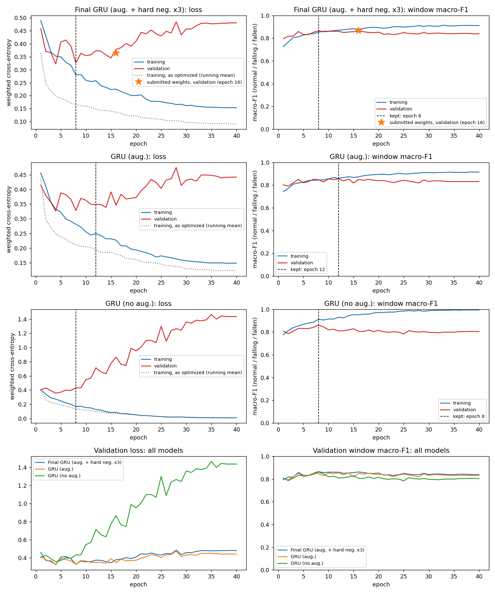

# FallVision: person collapse detection — project report

DS5602 Computer Vision, course project. Team ID, members and roll numbers: `TEAM.md`. Code: `README.md`;
every experiment: `APPROACHES_AND_EXPERIMENTS.md`.

## 1. Task
Detect when a person falls (collapses) in a video and localize the event: **who** (track ID), **where**
(bounding box), **when** (alarm time, with the estimated onset recorded separately). The system must
process video sequentially using only current and past frames, raise alarms as they occur, run offline
from one `config.yaml`, catch falls from sitting, raise no false alarms for lying down or exercise, work
at night, and use only YOLO11 as the pretrained vision model.

## 2. Method
1. **Frame sampling** on a 15-frames-per-second time grid (whatever the video's rate).
2. **YOLO11m-pose** (Ultralytics, pretrained on COCO keypoints; input 640 px, 960 px while people are
   small) finds every person and 17 body joints; **ByteTrack** gives each person an ID; a new ID that
   appears within 1.5 s and one body height of a lost one is joined to the same person.
3. **92 features per frame per person**, from that person's past 10 s only: 34 joint positions relative
   to the hip centre and divided by the standing height, 34 joint velocities, 17 joint confidences, 7
   whole-body cues (head-top height above the floor and its speed, box height / standing height, box
   aspect, torso angle, hip speed, "seen" flag). Gaps ≤ 0.5 s are interpolated, longer gaps marked.
4. **GRU classifier** on the last 2 s (30 frames), every 0.5 s: 2 layers, hidden 128, dropout 0.3, head
   on [last state, mean state] → *normal / falling / fallen*.
5. **Alarm logic:** score = P(falling) + P(fallen), averaged with the previous window; an alarm is
   raised the moment a person's score reaches the threshold **0.8573** (chosen on validation);
   `decision_timestamp_s` is the latest frame used; `onset_estimate_s` is the moment of the fastest head
   drop inside the window; the same person can alarm again only after 10 s below the threshold. All
   state is reset per video. Every setting is in `config.yaml`.

Why skeletons rather than pixels: a skeleton is the same in the dark, at any distance and with any
camera, which is what unseen videos demand; the classifier is tiny (0.1 ms per frame).

## 3. Data and splits
| Dataset | Videos | Role | Licence |
|---|---|---|---|
| GMDCSA24 (staged, home, 4 subjects) | 160 | train S1 / validation S2 / test S3-4 | MIT |
| Le2i (staged, home/office/lecture room) | 190 | train / val / test (official split) | research |
| CAUCAFall (staged, varied lighting, hard daily actions) | 97 | train / val / test (official split) | research |
| MCFD (staged, multi-camera) | 192 | train only | research |
| OOPS fall clips (real-world internet videos) | 818 | **test only** | non-commercial research |
| Own recordings (day / night, near / far, 1-9 people) | 20 | **test only** | private |

Labels and splits: **OmniFall** (frame-accurate activity segments for all five datasets and official
cross-subject splits), so no actor appears in two splits. Final sizes: train 426, validation 76,
test_gmdcsa24 80, test_staged 57, test_oops 818, test_own 20. Window labels: *falling* (window overlaps a
fall by ≥ 0.5 s), *fallen* (ends while lying after a fall), *normal* otherwise, including lying down on
purpose, sitting down and exercise (these "hard negatives" get 3× training weight). 12,587 training
windows, 1,262 validation windows. Every choice (model, score, threshold, decision lag, settings) was
made on validation; each test set was run once. OOPS and own videos were never used for any choice.

## 4. Pretrained models and training settings
- **Pretrained:** YOLO11m-pose (Ultralytics 8.4.212, COCO keypoints), used as is; ByteTrack (no learning).
- **Trained by us:** the GRU (`src/train_gru.py`): AdamW (lr 1e-3, weight decay 1e-4), cosine schedule,
  batch 256, 40 epochs, class-weighted cross-entropy (weights ∝ 1/√count), gradient clipping 1.0, seed 0;
  features standardised with the training mean / std; the epoch with the best validation window macro-F1
  is kept (epoch 16 of 40). Augmentation (each with probability 0.5): mirror, rotation ±15°, scale
  0.9-1.1, joint noise, night (hide 10-40 % of joints, lower confidences), frame drop (≤ 20 %).
  Hard negatives ×3. Comparison models trained the same way: GRU without hard weighting, GRU without
  augmentation, and a Random Forest (300 trees on 460 window statistics).
- **Environment:** Python 3.13, PyTorch 2.11.0 + CUDA 13.0, Tesla T4 (Kaggle); exact versions in
  `requirements.txt` and `results/env_kaggle.txt`.

**Training and validation curves.** Per epoch: class-weighted cross-entropy (left) and window macro-F1
(right) on the training set (a fixed sample, no augmentation) and on the validation set, for the final
GRU and the two comparison GRUs; the dotted line is the loss actually optimised (with augmentation and
hard-negative weights); the dashed line marks the epoch kept. The curves come from re-running
`src/train_gru.py` with identical data, settings and seed in order to record every epoch
(`notebooks/07_training_curves.ipynb`, `results/curves/`); the orange star is the submitted
`gru_hard.pt` (kept at epoch 16) measured on the same validation windows, and it lies on the re-run's
validation curve (validation loss 0.363 vs 0.378, macro-F1 0.864 vs 0.862 at epoch 16), so the figure
describes the submitted training. GPU training is not bit-identical, which is why the re-run's best
epoch (8, macro-F1 0.865) differs slightly from the original's (16, 0.864).

| Model | Best epoch | Val macro-F1 | Train / val loss at best | Train / val macro-F1 at best |
|---|---|---|---|---|
| Final GRU (augmentation + hard negatives ×3) | 8 | 0.865 | 0.281 / 0.327 | 0.851 / 0.865 |
| GRU, augmentation only | 12 | 0.855 | 0.249 / 0.349 | 0.860 / 0.855 |
| GRU, no augmentation | 8 | 0.862 | 0.168 / 0.431 | 0.912 / 0.862 |
| Submitted weights (`gru_hard.pt`) | 16 | 0.864 | – / 0.363 | – / 0.864 |

What the curves show: **without augmentation the model overfits** — training loss falls to almost zero
and training macro-F1 to 1.0 while the validation loss climbs from about epoch 5 (0.36 → 1.44) and
validation macro-F1 drifts down to 0.80. **With augmentation** the gap stays small (training loss 0.15-0.28
against validation 0.33-0.48) and validation macro-F1 stays on a plateau of 0.84-0.87 for the whole run.
Validation macro-F1 peaks early (epochs 8-16) and the validation loss rises slowly afterwards, which is why
the best-validation epoch is kept rather than the last one; 40 epochs with a cosine schedule is more than
enough. Hard negatives do not change the window-level curves much (their effect is on video-level false
alarms, Section 5), and all three models reach a similar window macro-F1 on validation, so the final choice
was made on video-level validation F1 (`results/fusion.md`).

## 5. Validation and test results
Submitted frame-by-frame system (`infer.py` engine, threshold 0.8573 chosen on validation; one alarm per
video counts; `results/causal_eval.md`):

| Split | Videos | F1 | Precision | Recall | False alarms | Missed falls | Median alarm delay |
|---|---|---|---|---|---|---|---|
| validation | 76 | 0.965 | 0.932 | 1.000 | 3 | 0 | 1.6 s |
| test GMDCSA24 S3-4 | 80 | 0.875 | 0.833 | 0.921 | 7 | 3 | 1.9 s |
| test staged (Le2i, CAUCAFall) | 57 | 0.968 | 0.968 | 0.968 | 1 | 1 | 1.5 s |
| test OOPS (real world) | 818 | 0.855 | 0.958 | 0.772 | 25 | 169 | 1.1 s |
| own recordings | 20 | 0.857 | 1.000 | 0.750 | 0 | 5 | 1.0 s |

Model comparison (whole-video evaluation, thresholds chosen on validation): rules v2 F1 0.870 / 0.741 /
0.384 (GMDCSA24 / staged / OOPS); Random Forest 0.909 / 0.949 / 0.691; GRU without augmentation
0.944 / 0.830 / 0.566; GRU with augmentation 0.914 / 0.933 / 0.798; GRU with augmentation and hard
negatives (final) 0.947 / 0.912 / 0.763. Augmentation is what makes the model work on real-world
video; hard negatives gave the best validation F1 and fewer false alarms on the staged sets. Decision
lags of 0.5-1.5 s lowered validation average precision (0.958 → 0.923), so lag 0 is used.

Other measurements: alarm box on the person who fell in 92 % of 36 checked alarms; estimated onset within
0.3-0.5 s of the label; 29.6 frames/s on a T4 (2× real time), about 2-3 frames/s on a laptop CPU.

## 6. Failure cases
- **Far-away / very small person:** YOLO loses the person exactly when they fall (9 of the 12 worst
  OOPS misses had the person detected in only 6-21 % of frames; own videos 002 and 009).
- **Moving or shaking camera** (OOPS): image motion is mistaken for body motion.
- **Very fast or blurred falls**, person leaving the frame.
- **Fall inside a group** (own video 011): the tracker gives the faller a new ID at the fall.
- **Fall from sitting in our own video 013** scored 0.63, below the threshold, in the frame-by-frame
  system (it was caught when the whole clip was visible): the "past frames only" rule costs a little
  recall; a longer window or an onset-aware threshold is future work.
- **False alarms:** lying down on purpose (2 of 6 analysed), push-ups (1 of 6); more people in view
  means more chances of a false alarm (hard validation crowds).
- **Label problems** in the datasets (e.g. a fall labelled "lie down"; 77 OOPS clips without a fall label).

Tried and not kept: image brightening at night (made things worse), zoom re-check for small people,
input 1280, low-confidence tracking, fall-aware track joining, a higher threshold from the hard
validation set, model averaging (`results/summary.md`).

## 7. Reproducibility
`python run_pipeline.py --omnifall-root … --gmd-root … --work work --all-models --device cuda:0`
runs pose caching, features, windows, training (with curves), model choice and the final evaluation on
CPU or GPU; `kaggle/project_kaggle.ipynb` runs the same on Kaggle. Retraining re-chooses the threshold
on validation and writes it to `config.yaml`. Unit tests: `python -m pytest tests`.

## 8. Individual contributions
| Member | Contributions |
|---|---|
| Member 1 | Data and evaluation: labelled 18 of the team's own videos (fall type, start time, lighting, distance, number of people) in the label sheet used by the evaluation scripts; manual localization study (36 alarm frames checked by eye: is the box on the person who fell), which gives the 92 % figure; watched and classified the missed falls and false alarms for the error analysis. |
| Member 2 | Design and implementation of the system: OmniFall-based splits, pose caching with YOLO11m-pose and ByteTrack, the 92 skeleton features and 2-s windows, the GRU models (augmentation, hard negatives) and the Random Forest baseline, model and threshold selection on validation, the frame-by-frame inference engine and `infer.py`, the evaluation scripts, the night / far-away robustness experiments, the Kaggle pipeline notebooks, documentation and the submission package; repository owner. |
| Member 3 | Test data: planned and recorded the 20 own test videos (day and night, near and far, one to nine people; falls from standing, walking, sitting and jumping) following the recording plan, kept in a private dataset; ran the own-video checker and the own-video evaluations and reported their results. |

Names and roll numbers: `TEAM.md`.
