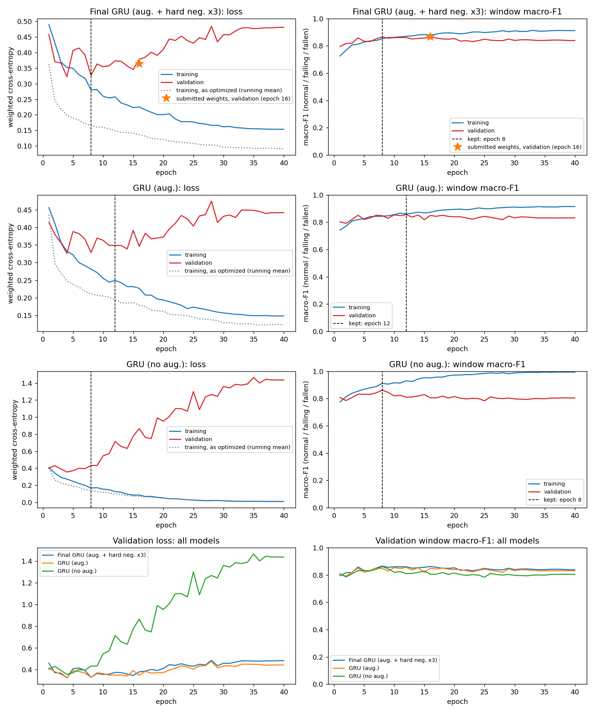

# Training and validation curves

| Model | Best epoch | Val macro-F1 (best) | Train loss / val loss at best | Train / val macro-F1 at best |
|---|---|---|---|---|
| Final GRU (aug. + hard neg. x3) | 8 | 0.865 | 0.281 / 0.327 | 0.851 / 0.865 |
| GRU (aug.) | 12 | 0.855 | 0.249 / 0.349 | 0.860 / 0.855 |
| GRU (no aug.) | 8 | 0.862 | 0.168 / 0.431 | 0.912 / 0.862 |
| Submitted weights (gru_hard.pt) | 16 | 0.864 | - / 0.363 | - / 0.864 |

